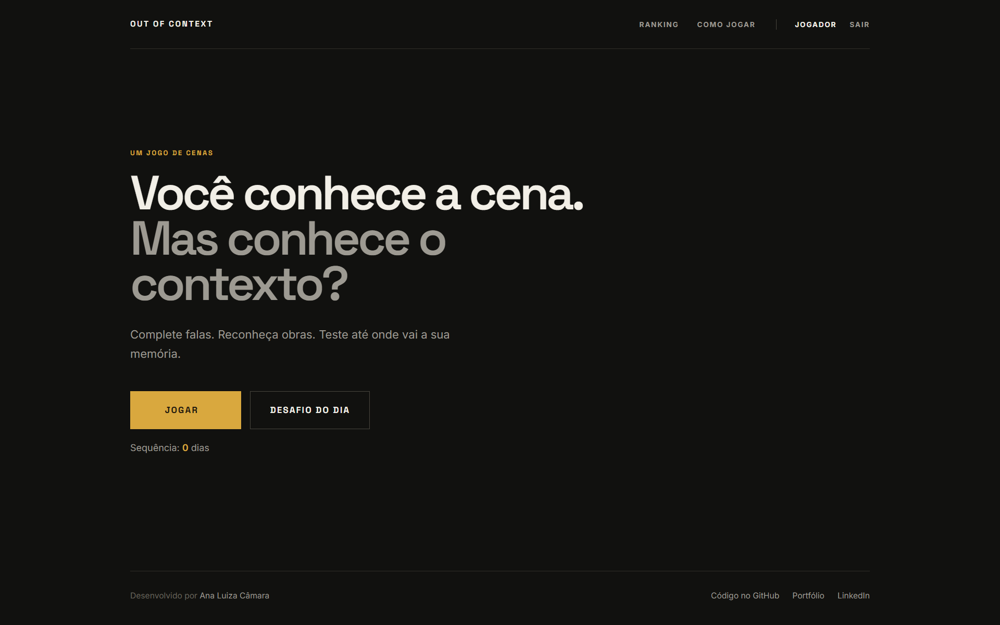
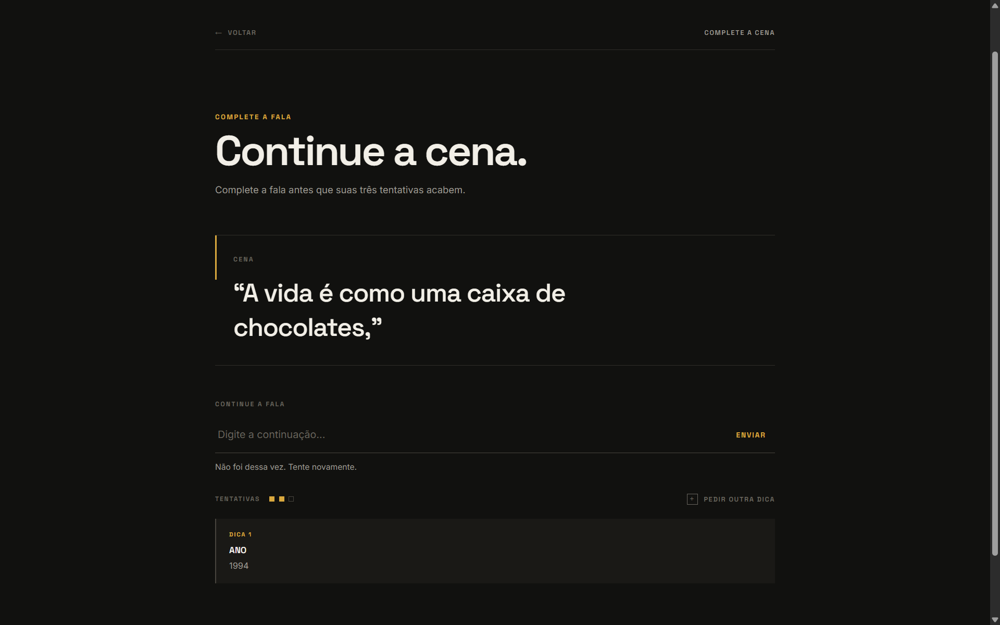
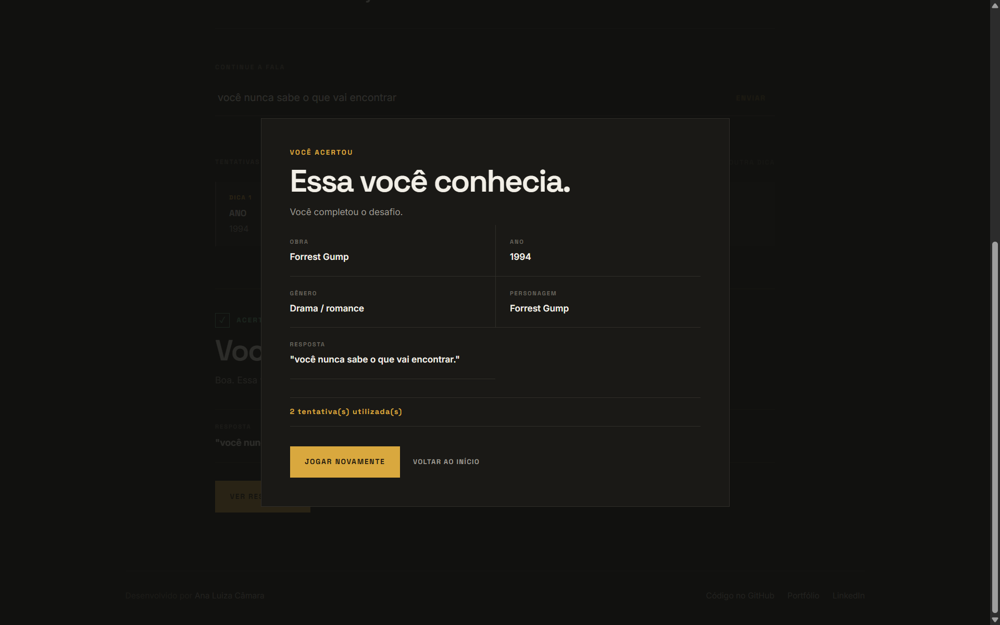
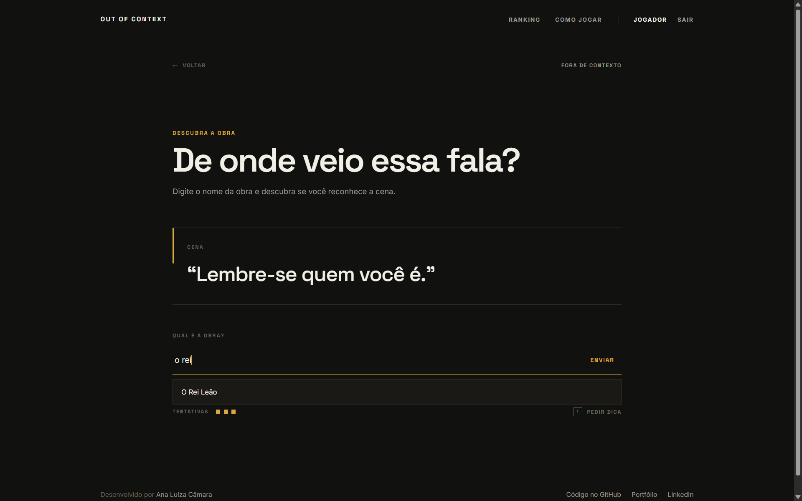
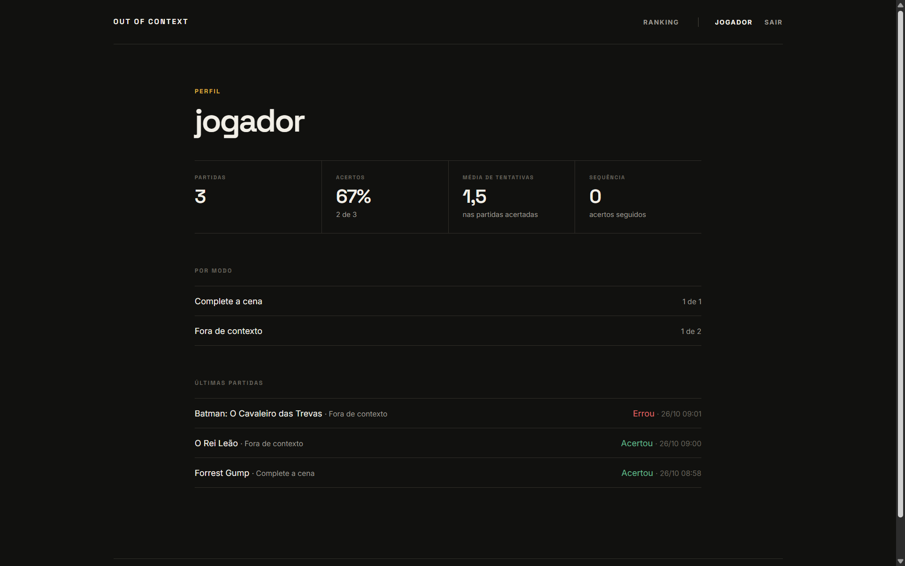
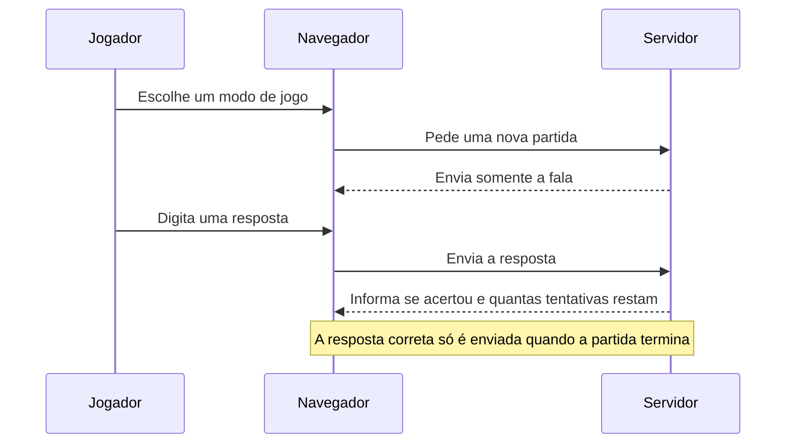

# Out of Context

> Você conhece a cena. Mas conhece o contexto?


Out of Context é um jogo web de cenas de filmes. A cada rodada, o jogador recebe uma
fala e precisa completá-la ou descobrir de qual obra ela veio, com três tentativas e
dicas progressivas.

**Jogar:** https://out-of-context.onrender.com/

| Tela inicial | Rodada em andamento | Resultado |
|---|---|---|
|  |  |  |
 
| Modo Fora de contexto | Perfil |
|---|---|
|  |  |

## Sobre o projeto

O projeto começou como um protótipo em HTML, CSS e JavaScript e foi reconstruído com
Django. A mudança permitiu acrescentar contas de usuário, estatísticas, ranking e um
desafio diário igual para todos os jogadores.

## Como se joga

- **Complete a cena:** a fala aparece cortada e o jogador escreve a continuação.
  Pequenos erros de digitação são aceitos.
- **Fora de contexto:** a fala aparece completa e o jogador descobre a obra de onde ela
  veio, com sugestões de títulos enquanto digita.
- **Desafio do dia:** uma cena por dia, igual para todos, com uma única partida por
  jogador. O jogo conta quantos dias seguidos o jogador acertou.
- **Dicas:** em qualquer partida, é possível pedir até três dicas: ano, gênero e
  personagem.
- **Perfil e ranking:** cada jogador acompanha a própria taxa de acerto e o histórico,
  e o ranking mostra quem mais acertou e quem tem a maior sequência no desafio do dia.

## Como foi feito

### Do protótipo ao servidor

No protótipo, tudo acontecia no navegador: as cenas ficavam em um arquivo e a lógica do
jogo rodava em JavaScript, o que deixava a resposta correta visível para qualquer pessoa
que olhasse o código da página. Na versão atual, o servidor (Django) cuida do jogo, e o
navegador só mostra a interface e envia as respostas.

### O caminho de uma rodada



As tentativas e as dicas também são contadas no servidor, e as respostas têm um limite de
tamanho. Assim, a rodada não pode ser burlada alterando a página.

### Como uma resposta é conferida

1. O texto digitado é padronizado: letras minúsculas, sem acentos e sem pontuação.
2. No **Complete a cena**, ele é comparado com a continuação correta pela **distância de
   Levenshtein**, que conta quantas letras precisam ser trocadas, inseridas ou removidas
   para transformar um texto em outro. O algoritmo foi implementado em Python, sem
   bibliotecas externas. A resposta é aceita quando o texto tem pelo menos 85% de
   semelhança, o que perdoa pequenos erros de digitação, mas não respostas incompletas.
3. No **Fora de contexto**, é aceito o título completo (também com pequenos erros) ou um
   trecho dele formado por palavras inteiras. Assim, "Harry Potter" vale para "Harry
   Potter e a Pedra Filosofal", mas um pedaço solto de palavra não vale.

### Cenas, obras e administração

As cenas e as obras ficam em um banco de dados e são cadastradas pelo painel
administrativo do Django. Um comando importa as cenas iniciais de um arquivo, e pode ser
executado de novo sem duplicar nada.

### O desafio do dia

- A cena do dia é sorteada na primeira visita do dia, evitando repetir cenas já usadas, e
  é a mesma para todos os jogadores.
- Cada jogador tem uma única partida por desafio, e o banco de dados impede que haja mais
  de uma. Se a página for recarregada no meio da partida, as tentativas e as dicas já
  usadas continuam como estavam.
- A sequência conta os dias seguidos com acerto. Enquanto o jogador ainda não jogou hoje,
  ela parte do dia anterior, para não zerar à meia-noite.
- A virada do dia segue o fuso horário do projeto.

### Contas, perfil e ranking

O cadastro e o login usam o sistema de contas do Django. Cada partida fica ligada a um
jogador, e o banco de dados calcula a taxa de acerto, a média de tentativas e o ranking.
Quem não tem conta pode jogar as partidas comuns, mas sem histórico.

### Testes e publicação

O projeto tem mais de quarenta testes automatizados, que cobrem as regras do jogo, o
desafio diário, o ranking, as contas e o cadastro de cenas. A aplicação está publicada no
Render, com o banco de dados no Neon, e o site é atualizado a cada envio ao GitHub.

## Tecnologias

| Camada | Tecnologia |
|---|---|
| Aplicação | Python e Django |
| Interface | HTML, CSS e JavaScript |
| Banco de dados | PostgreSQL em produção e SQLite em desenvolvimento |
| Hospedagem | Render (aplicação) e Neon (banco de dados) |

## Executar localmente

```powershell
python -m venv .venv
.venv\Scripts\activate          # Mac/Linux: source .venv/bin/activate
pip install -r requirements.txt
python manage.py migrate
python manage.py importar_cenas dados/cenas.json
python manage.py runserver
```

A aplicação fica disponível em http://127.0.0.1:8000/. Para acessar o painel
administrativo (`/admin/`), é necessário criar um usuário com
`python manage.py createsuperuser`. Os testes automatizados são executados com
`python manage.py test`.

## Autoria

Desenvolvido por Ana Luiza Câmara. [Portfólio](https://anavcamara.github.io/) · [GitHub](https://github.com/anavcamara)
